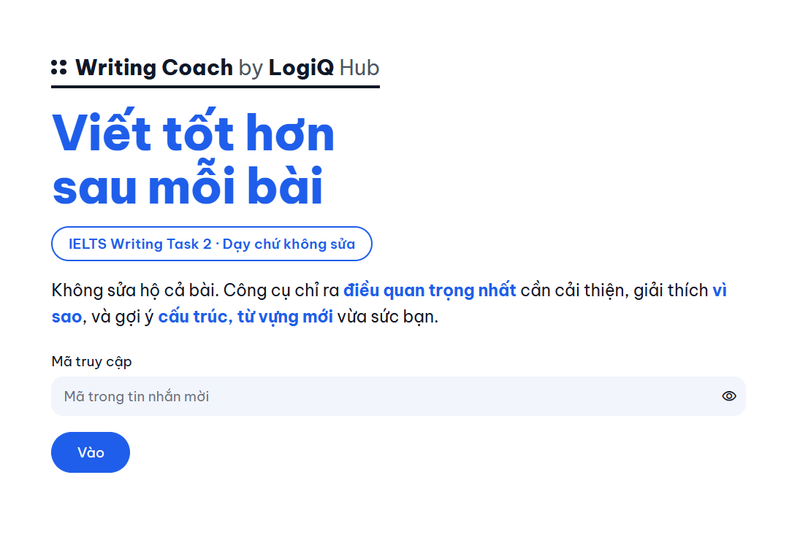
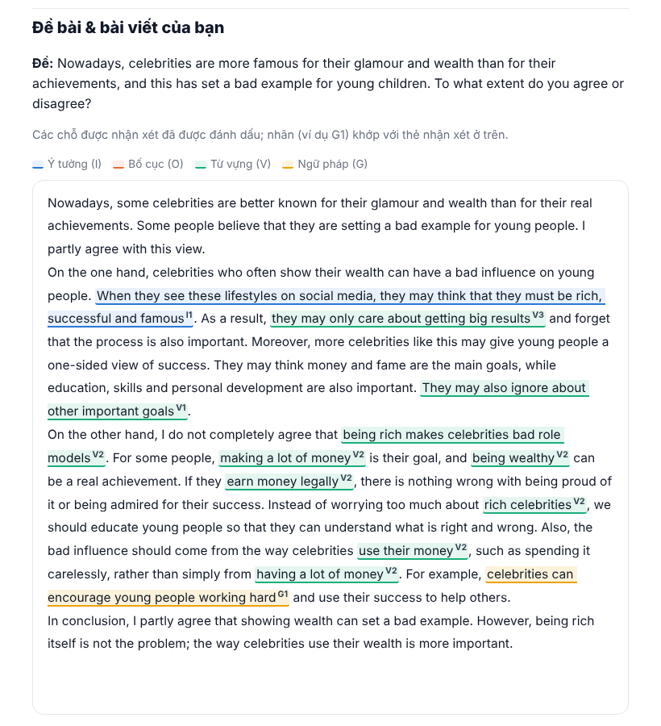
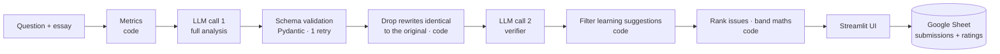
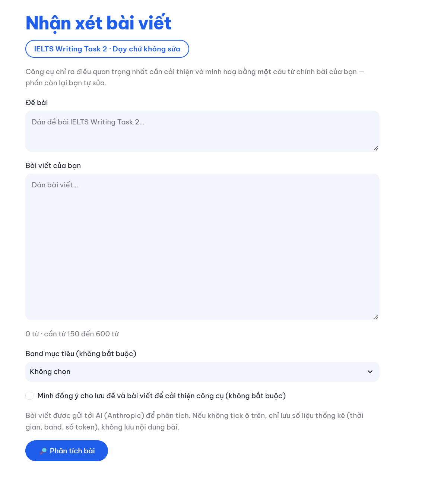
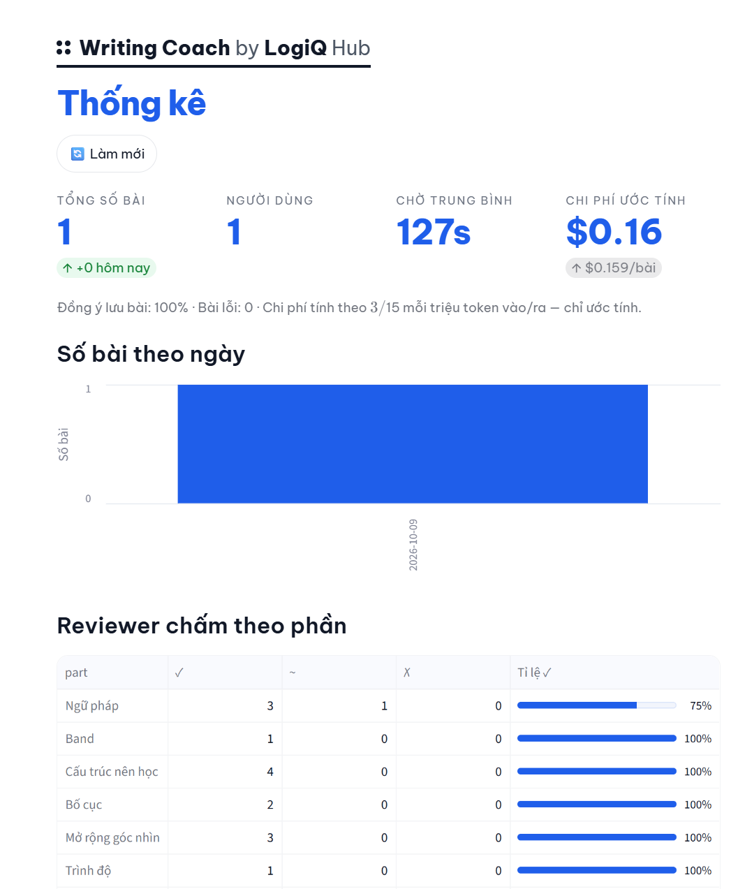

# ✍️ Writing Coach

**An LLM-powered feedback tool for IELTS Writing Task 2 that teaches instead of rewriting.**
For each problem it finds, it explains *why* it matters, names *what to learn*, and rewrites **exactly one sentence** from the learner's own essay as an example — the learner fixes the rest.

🔗 **Live app:** [writing-coach-logiq.streamlit.app](https://writing-coach-logiq.streamlit.app/) *(pilot — access code required; screenshots below)*

<p>
  
  
</p>

---

## Why this exists

I teach IELTS and work as a data analyst. Grammarly, QuillBot or pasting an essay into ChatGPT make *today's* essay better — they rarely make the *next* one better. Three problems show up again and again with generic LLM feedback:

1. **It rewrites everything.** The learner copies the fix and learns nothing.
2. **It suggests language far above the learner's level** ("paramount", "prerequisite" for a B1 writer), which they then misuse.
3. **It invents or mislabels errors.** In my own evaluation (below), 5 of 8 grammar issues flagged by the model in one round were wrong — sentences that were already correct, or a real error given the wrong name.

Writing Coach is built around those three problems, and each design decision is backed by an evaluation round.

## What it does

| Feature | Detail |
|---|---|
| **4 aspects, ideas first** | Ideas & argument → Organisation → Vocabulary → Grammar (mapped to the IELTS criteria TR · CC · LR · GRA). Fixing grammar in a sentence that should be cut is wasted effort |
| **At most 4 issues per aspect — a ceiling, not a quota** | Asking an LLM for "4 issues" makes it invent them; the prompt and schema enforce a maximum only |
| **One-sentence rewrite** | Every issue: quote → why it matters → what to learn (with CEFR level) → one rewritten sentence → where to apply it yourself |
| **i+1 level control** | Estimates the learner's CEFR level separately for vocabulary and grammar, and keeps every suggestion at most one level above |
| **Learning list** | 3–4 new grammar structures and 4–6 vocabulary chunks the essay does not use yet, each shown on a sentence from the learner's essay |
| **Highlighted essay** | Every quoted sentence is highlighted in place with a label (`G1`, `V2`) that links to its feedback card |
| **Downloadable review sheet** | A branded HTML file with a ☐ checklist of everything to practise (print to PDF) |
| **Estimated band** | Per criterion + overall, computed by code (IELTS rounding rules, < 250-word cap) and shown *after* the feedback, not before |

**Bilingual by design.** Users are Vietnamese learners (band 4.5–7.0): explanations are in Vietnamese, while quotes, rewrites and suggested language stay in English, and grammar terms are given in both ("mệnh đề quan hệ (relative clause)"). The UI is in Vietnamese for the same reason.

## How it works



**Principle: the LLM does judgement; code does anything that can be checked.**

- **Structured output.** The model answers through a forced tool call whose JSON schema is generated from Pydantic models (`core/schema.py`); output that fails validation is retried once with the validation error.
- **Code-side computation.** Word count, sentence complexity, repeated words (`core/metrics.py`) are computed and given to the model as evidence. Issue ranking (severity, then ease of fixing), the overall band and the short-essay cap are computed in code, never by the model.
- **A separate verifier call** (`core/verifier.py`) re-checks every grammar and vocabulary claim against the essay and returns `real` / `mislabeled` (renames the issue) / `not_real` (drops it). It fails open: if the verifier errors, the result is still returned with a warning.
- **Deterministic filters** (`core/filters.py`) remove learning suggestions the learner already uses (phrase already in the essay, example sentence identical to the original, an "alternative" that contains the over-used word itself).

## Evaluation — the part I'm most proud of

Every change was tested on a fixed set of essays and reviewed **item by item** by a teacher (me): each piece of feedback marked ✓ correct and useful / ~ correct but needs work / ✗ wrong or harmful, with a fixed label for the failure type (`fake`, `too_hard`, `duplicate`, `rewrite_off`, …). One change per round; every round is logged in [`evaluation/EXPERIMENTS.md`](evaluation/EXPERIMENTS.md).

| Version | Main change | Feedback items ✓ | Grammar issues marked ✗ |
|---|---|---|---|
| v2 | Prompt rules: one problem = one aspect, hard i+1 limit, rewrite fixes only the issue | 81% (35/43) | 2 / 9 |
| v3 | "Re-check before reporting" instruction in the prompt + richer suggestions | 83% (30/36) | **5 / 8** ⬆ |
| v4 | **Separate verifier call** + code filter for identical rewrites | **97% (29/30)** | **0 / 3** |
| v4.1 | Deterministic filters for learning suggestions | caught 3/3 remaining ✗, 0 false positives | — |

What the data changed in my thinking:

- **Telling the model to be careful made it worse.** The v3 prompt instruction to "verify before reporting" *increased* wrong grammar issues (2/9 → 5/8). Moving verification into a separate call with a sceptical role fixed it (0/3). Every item the pipeline dropped (2 by the code filter, 1 by the verifier) was confirmed as a correct drop in review, and the verifier also renamed 3 mislabelled issues.
- **Limits belong in the right place.** Issues get only a *maximum* (minimums cause invented errors); learning suggestions get a *minimum* (they are not errors, so a minimum is harmless and guarantees every learner leaves with something new).
- **Filters were tuned on the data, then tested on it.** Every threshold in `core/filters.py` was chosen on v4 outputs so that it caught every case the teacher marked ✗ without removing any marked ✓. A unit test caught a filter that would have shown learners half of their sentence as "deleted" before it shipped.

**Honest limitations.** The offline set is small (5 essays, ~30–45 feedback items per round), the same essays were used for all four rounds (so some overfitting is likely), there was a single reviewer, and the API does not allow fixing the temperature. That is why the next step is a live pilot (below) rather than more offline tuning.

**Cost and latency.** Two Claude Sonnet calls per essay: about 12k input / 5k output tokens, roughly **$0.11–0.16 per essay**, and **~2 minutes** end to end. Prompt caching is the next cost lever (see roadmap).

## Live pilot

<p>
  
  
</p>

- **Access codes with roles.** *Students* rate each piece of feedback 👍/👎 and can flag "I don't understand" or **"I think this isn't wrong"** — the cheapest possible signal for hallucinated errors. *Reviewers* (teachers) grade every item with the same ✓/~/✗ + label scheme used offline.
- **Storage.** Submissions and ratings go to a private Google Sheet via a service account. Essays are stored only with explicit opt-in consent; otherwise only usage statistics are kept.
- **Inter-rater agreement.** `evaluation/pull_sheet.py` turns the live data into the same review format as the offline rounds and reports how often reviewers agree. Reviewers first grade 2–3 shared essays so criteria can be aligned before their reviews are trusted.
- **Dashboard.** Reviewers get an in-app statistics page: volume, wait time, estimated cost, 👍 rate per feedback type, reviewer verdicts and the most common failure labels.
- **Limits.** Daily quotas per code and system-wide, plus a monthly spend cap on the API key.

## Tech stack

Python · Anthropic Claude API (tool use / structured output) · Pydantic · Streamlit (Community Cloud) · gspread + Google Sheets · pandas · pytest

## Repository structure

```
app.py                  Streamlit app (login, input, results, ratings, dashboard)
core/
  analyzer.py           pipeline: call 1 → validation → filters → verifier → band maths
  schema.py             Pydantic output contract (issues, learning lists, bands)
  verifier.py           call 2: re-checks grammar/vocabulary claims
  filters.py            deterministic filters for learning suggestions
  metrics.py            text metrics computed in code
  band.py               IELTS band rounding and caps
  llm.py                forced tool-call wrapper around the Claude API
  auth.py, storage.py   access codes & quotas, Google Sheets storage
ui/                     theme, highlighting, export, dashboard
prompts/                versioned prompts (ielts_v1 … v4, verify_v1)
evaluation/             run_eval.py (offline), pull_sheet.py (live), EXPERIMENTS.md, results/*/summary.csv
tests/                  unit tests — no API calls
data/samples/           public / self-written sample essays (no student data)
docs/                   design and working notes (mostly Vietnamese)
```

## Run locally

```bash
python -m venv .venv
.venv\Scripts\activate                    # Windows  ·  source .venv/bin/activate on macOS/Linux
pip install -r requirements.txt
cp .env.example .env                      # add ANTHROPIC_API_KEY
pytest                                    # unit tests, no API cost
python cli.py data/samples/sample_02.txt  # analyse one essay from the command line
streamlit run app.py                      # without secrets the app runs in dev mode (no login, no storage)
```

To enable login and storage, copy `.streamlit/secrets.toml.example` to `.streamlit/secrets.toml` and fill it in.

## Data & privacy

- No student essays, teacher labels, access codes or keys are in this repository (`.gitignore` blocks `data/gold/`, `evaluation/results/*/raw/`, `.env`, `secrets.toml`). Published evaluation files contain metrics only.
- Learners are told that essays are sent to an AI model for analysis; saving an essay is opt-in.

## Roadmap

Short-term: auto-save ratings, a 3-question learner survey, mobile polish, prompt caching. Longer-term: CEFR word lists for code-level i+1 checks, a held-out test set for published numbers, Google login, an "other writing" mode (emails, personal statements), learner history and progress tracking. Details in [`docs/roadmap.md`](docs/roadmap.md) (Vietnamese).

## About

Built by **Vu Dam** — data analyst (5+ years) and IELTS teacher — as a learn-by-building portfolio project in LLM application design and evaluation. Evolved from an earlier prototype that scored essays and diagnosed grammar; the full design document is in [`docs/design_v0.3.md`](docs/design_v0.3.md) (Vietnamese).
